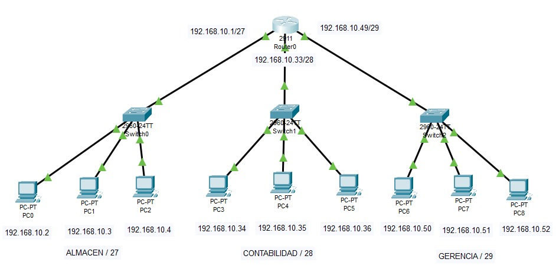
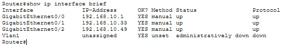
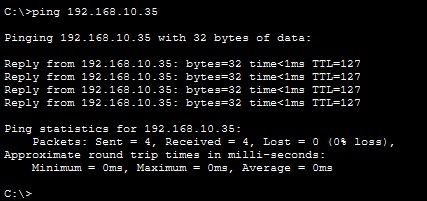
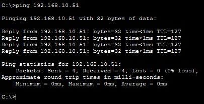

# Lab 03 · Red empresarial con subnetting

Tercer laboratorio práctico de redes. Diseñé e implementé en Cisco Packet Tracer la red de una empresa con tres áreas (Almacén, Contabilidad y Gerencia), dividiendo la red `192.168.10.0` en subredes de distinto tamaño según la cantidad de equipos de cada área. Configuré un router Cisco 2911 por CLI con una interfaz por subred y verifiqué la comunicación entre todas las áreas con `ping`, obteniendo 0% de pérdida de paquetes.

## 🎯 Objetivo

Aplicar subnetting para asignar a cada área una subred del tamaño adecuado, sin desperdiciar direcciones, y comunicarlas mediante un router.

## 🗺️ Topología



## 🖥️ Equipos utilizados

| Equipo | Modelo | Cantidad |
|---|---|---|
| Router | Cisco 2911 | 1 |
| Switch | Cisco 2960 | 3 |
| PC | PC-PT | 9 |
| Cable | Cobre directo (straight-through) | 12 |

## 📐 Diseño de subredes

Se calculó el tamaño de cada subred según los equipos necesarios (equipos + 2 direcciones reservadas) y se asignaron de la más grande a la más pequeña.

| Área | Subred | Máscara | Rango de hosts | Broadcast |
|---|---|---|---|---|
| Almacén | `192.168.10.0/27` | `255.255.255.224` | `.1` – `.30` | `.31` |
| Contabilidad | `192.168.10.32/28` | `255.255.255.240` | `.33` – `.46` | `.47` |
| Gerencia | `192.168.10.48/29` | `255.255.255.248` | `.49` – `.54` | `.55` |

Las direcciones desde `192.168.10.56` hasta `.255` quedan libres para futuras áreas.

## 🔢 Tabla de direccionamiento

| Área | Dispositivo | Dirección IP | Puerta de enlace |
|---|---|---|---|
| Almacén | Router G0/0 | `192.168.10.1` | — |
| Almacén | PC0, PC1, PC2 | `.2`, `.3`, `.4` | `192.168.10.1` |
| Contabilidad | Router G0/1 | `192.168.10.33` | — |
| Contabilidad | PC3, PC4, PC5 | `.34`, `.35`, `.36` | `192.168.10.33` |
| Gerencia | Router G0/2 | `192.168.10.49` | — |
| Gerencia | PC6, PC7, PC8 | `.50`, `.51`, `.52` | `192.168.10.49` |

## ⚙️ Configuración del router

```
enable
configure terminal
interface g0/0
ip address 192.168.10.1 255.255.255.224
no shutdown
exit
interface g0/1
ip address 192.168.10.33 255.255.255.240
no shutdown
exit
interface g0/2
ip address 192.168.10.49 255.255.255.248
no shutdown
end
copy running-config startup-config
```

## ✅ Pruebas

### Estado de las interfaces (`show ip interface brief`)

Las tres interfaces del router aparecen en estado `up/up` con su IP correspondiente.



### Almacén → Contabilidad

Ping desde PC0 (`192.168.10.2`) hacia PC4 (`192.168.10.35`): **4 paquetes enviados, 4 recibidos, 0% de pérdida.**



### Almacén → Gerencia

Ping desde PC0 (`192.168.10.2`) hacia PC7 (`192.168.10.51`): **4 paquetes enviados, 4 recibidos, 0% de pérdida.** El valor `TTL=127` confirma que el paquete atravesó el router.



## 🧠 Conclusiones

- Con subnetting asigné a cada área una red del tamaño justo según sus equipos, usando solo 56 direcciones en lugar de desperdiciar una red /24 completa por área.
- Al asignar de la subred más grande a la más pequeña, las redes quedan ordenadas y sin superponerse, dejando el resto libre para futuras áreas.

## 📂 Archivos

- [`lab03-subnetting.pkt`](./lab03-subnetting.pkt) → abrir con Cisco Packet Tracer