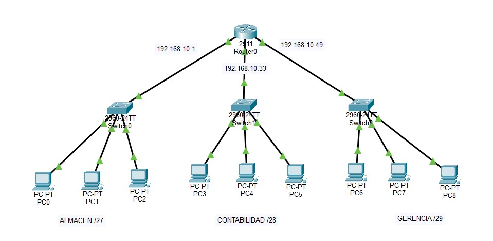
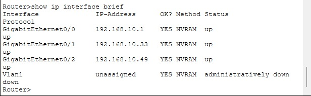
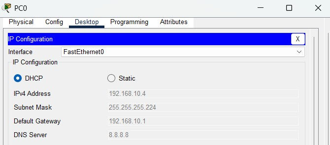
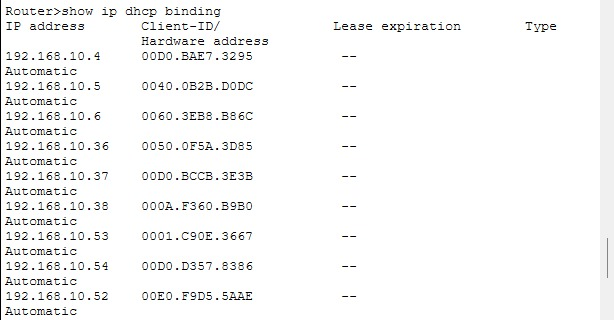
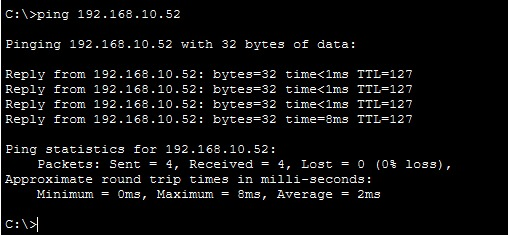

# Lab 04 · DHCP en la red de tres áreas

Cuarto laboratorio práctico de redes. Construí desde cero en Cisco Packet Tracer una red empresarial con tres áreas en subredes distintas y configuré un servidor DHCP en el router Cisco 2911, con un pool por área y exclusiones para equipos fijos. Las 9 PCs reciben automáticamente su IP, máscara, puerta de enlace y DNS, y se comunican entre áreas con 0% de pérdida de paquetes.

## 🎯 Objetivo

Automatizar la asignación de direcciones IP mediante DHCP en una red con subnetting, reservando direcciones para equipos fijos en cada área.

## 🗺️ Topología



## 🖥️ Equipos utilizados

| Equipo | Modelo | Cantidad |
|---|---|---|
| Router | Cisco 2911 | 1 |
| Switch | Cisco 2960 | 3 |
| PC | PC-PT | 9 |
| Cable | Cobre directo (straight-through) | 12 |

## 📐 Diseño DHCP

| Área | Subred | Router (gateway) | Excluidas (equipos fijos) | Rango DHCP |
|---|---|---|---|---|
| Almacén | `192.168.10.0/27` | `192.168.10.1` | `.1` – `.3` | `.4` – `.30` |
| Contabilidad | `192.168.10.32/28` | `192.168.10.33` | `.33` – `.35` | `.36` – `.46` |
| Gerencia | `192.168.10.48/29` | `192.168.10.49` | `.49` – `.51` | `.52` – `.54` |

Cada pool entrega a las PCs: dirección IP, máscara, puerta de enlace y DNS (`8.8.8.8`).

## ⚙️ Configuración del router

```
interface g0/0
 ip address 192.168.10.1 255.255.255.224
 no shutdown
interface g0/1
 ip address 192.168.10.33 255.255.255.240
 no shutdown
interface g0/2
 ip address 192.168.10.49 255.255.255.248
 no shutdown
exit

ip dhcp excluded-address 192.168.10.1 192.168.10.3
ip dhcp excluded-address 192.168.10.33 192.168.10.35
ip dhcp excluded-address 192.168.10.49 192.168.10.51

ip dhcp pool ALMACEN
 network 192.168.10.0 255.255.255.224
 default-router 192.168.10.1
 dns-server 8.8.8.8
ip dhcp pool CONTABILIDAD
 network 192.168.10.32 255.255.255.240
 default-router 192.168.10.33
 dns-server 8.8.8.8
ip dhcp pool GERENCIA
 network 192.168.10.48 255.255.255.248
 default-router 192.168.10.49
 dns-server 8.8.8.8
end
copy running-config startup-config
```


## ✅ Pruebas

### Interfaces del router

Las tres interfaces en estado `up/up`.



### PC recibiendo IP por DHCP

PC0 obtuvo automáticamente la IP `192.168.10.4`, la primera disponible después de las exclusiones de Almacén.



### Asignaciones del DHCP (`show ip dhcp binding`)

Las 9 PCs recibieron una IP de su propia subred: 3 por área, empezando justo después de cada rango excluido.



### Comunicación entre áreas

Ping desde PC0 de Almacén (`192.168.10.4`) hacia PC8 de Gerencia (`192.168.10.52`): **4 paquetes enviados, 4 recibidos, 0% de pérdida.**



## 🛠️ Problemas encontrados y solución

1. **Exclusiones duplicadas:** al corregir rangos, los comandos nuevos se sumaban a los anteriores en lugar de reemplazarlos. Lo detecté con `show running-config` y eliminé las exclusiones incorrectas con `no ip dhcp excluded-address`.
2. **Máscara incorrecta en un pool:** el pool de Gerencia tenía `/28` en lugar de `/29`, lo que podía repartir IPs fuera de su subred. Se corrigió la máscara.
3. **Préstamos antiguos en el DHCP:** una PC no recibía IP porque el router conservaba asignaciones de configuraciones anteriores. Se limpiaron reiniciando el router (equivalente a `clear ip dhcp binding *`) y se renovó la IP de cada PC.

## 🧠 Conclusiones

- Con DHCP las PCs reciben su configuración de red automáticamente, lo que evita errores manuales como las IPs duplicadas; las exclusiones reservan direcciones para equipos fijos como el router.
- `show running-config` y `show ip dhcp binding` fueron clave para diagnosticar errores: me permitieron ver exclusiones sobrantes y préstamos antiguos que impedían asignar IPs.

## 📂 Archivos

- [`lab04-dhcp.pkt`](./lab04-dhcp.pkt) → abrir con Cisco Packet Tracer